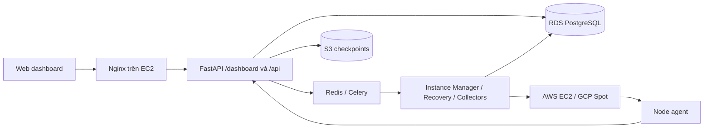

# Web dashboard

Giao diện tiếng Việt chạy tại **`/dashboard/`** trên cùng domain với API. Truy cập
`/` sẽ chuyển tới dashboard. Giao diện được đóng gói trong image control-plane
hiện tại, không cần Node.js, một web server khác hoặc một database khác.

## Chức năng

- Đăng nhập/đăng ký bằng tài khoản hiện có; phiên JWT được lưu trong
  `sessionStorage` của tab và xóa khi đăng xuất/hết hạn.
- Tổng quan số máy, chi phí Spot, chi phí giả định On-demand, chênh lệch, biểu đồ
  7/30/90 ngày và các lần khôi phục gần đây.
- Danh sách máy: tìm theo tên, lọc trạng thái, phân trang; giá mỗi giờ và chi phí
  tích lũy. Trạng thái phản ánh cả yêu cầu xóa và trường hợp cần người dùng xử lý.
- Chi tiết máy: tài nguyên yêu cầu/thực tế, IP và lệnh SSH, giá, lịch sử instance,
  lịch sử recovery, job, heartbeat và vị trí checkpoint trên S3. Có thao tác xóa
  và thử lại qua Instance Manager hiện có.
- Tạo máy qua ba bước: nhập nhu cầu → chọn đề xuất → xác nhận. Hỗ trợ CPU/RAM/GPU,
  disk, provider, region/zone, mục tiêu tối ưu, job ID và startup script tùy chọn.
  Ước tính số giờ trên form chỉ để so sánh, không phải lịch tự dừng máy.
- Thêm/liệt kê SSH public key để người dùng có thể hoàn thành luồng tạo máy.
- Giao diện responsive, bảng cuộn ngang trên điện thoại; điều hướng bàn phím,
  thông báo lỗi/đang tải/trống và xác nhận trước khi xóa.

Tổng quan/danh sách/chi tiết được kiểm tra lại mỗi 15 giây khi tab đang hiển thị;
không thay nội dung lúc người dùng đang tương tác với form, nút hoặc bảng mở rộng.
Có nút làm mới thủ công. Đây là dữ liệu đã được worker đồng bộ vào database,
không phải truy vấn trực tiếp EC2/GCP mỗi lần mở trang.

## Cách gắn vào kiến trúc hiện tại



Dashboard dùng các API auth/SSH/machines hiện có; API mới chỉ cung cấp mô hình
đọc tổng hợp và tính chi phí. Tất cả `/api/dashboard*` đều bắt buộc đăng nhập và
lọc theo chủ sở hữu. Trình duyệt không nhận AWS credentials, launch network config,
agent token, nội dung script đang chạy hoặc dữ liệu checkpoint nhúng.

| Thành phần đã đọc | Trách nhiệm và cách tích hợp |
| --- | --- |
| `app/main.py`, `auth.py`, `security.py`, `api_keys.py`, `ssh_keys.py`, `ssh.py` | Giữ cơ chế xác thực/phân quyền và SSH hiện có; thêm router/static mount |
| `app/models.py`, `database.py`, `init_db.py`, `seed.py` | Dùng schema hiện có; phân biệt Machine với lịch sử Instance; không dùng dữ liệu seed làm giá production |
| `app/services/catalog.py`, `placement.py`, `app/placement.py` | Lọc tài nguyên, giá, rủi ro và xếp hạng; thêm tùy chọn lọc theo launch allowlist |
| `app/services/instance_manager.py`, `launch_config.py`, `cloud_errors.py`, `app/machines.py` | Ghi ý định tạo/xóa bền vững; worker thực thi; ưu tiên ứng viên đã chọn và giữ fallback |
| `app/services/recovery.py`, `managed_agent.py` | Khôi phục từ yêu cầu ban đầu; không khóa recovery vào ứng viên ưu tiên |
| `app/adapters/{base,aws,gcp,cloud_init}.py` và script bootstrap/kiểm tra adapter | Cloud adapters tạo/xóa VM và cấu hình agent; dashboard không gọi trực tiếp |
| `app/services/market_data_collector.py`, `tasks.py`, `celery_app.py` | Giữ collector Spot/risk; thêm collector On-demand AWS hằng ngày |
| `app/agent_api.py`, `submissions.py`, `checkpoint_storage.py` | Dùng thông tin job thuộc người dùng; hiển thị metadata checkpoint, không tải payload/credentials |
| Toàn bộ `node-agent/` | Agent chạy job/script, heartbeat, checkpoint và xử lý interruption; dashboard phản ánh trạng thái đã báo về |
| Toàn bộ `cli/` | Giữ tương thích API với CLI, bao gồm job/submission và Idempotency-Key |
| Test của control-plane, CLI, node-agent; Docker/Compose/Nginx, tài liệu Markdown và hai PDF dự án | Đối chiếu luồng thực tế trước khi viết; không thay mô hình EC2–RDS–S3 |

Mã mới chính: `app/dashboard.py`, `app/web.py`, `app/static/`,
`app/services/cost_and_metering.py`, `app/services/on_demand_pricing.py`.
Lỗi catalog không có region/zone dùng biến `conditions` chưa khởi tạo cũng đã
được sửa vì ảnh hưởng tra cứu cấu hình tổng quát.

## Chạy trên EC2

Dùng stack trong [README.md](README.md), cấu hình RDS bằng `DATABASE_URL` và
checkpoint bằng `SPULTI_CHECKPOINT_BUCKET` / `AWS_REGION` như hiện tại. Nếu máy
chưa có các bảng lifecycle/recovery/job, làm theo
[INSTANCE_MANAGER.md](INSTANCE_MANAGER.md) và [RECOVERY.md](RECOVERY.md).
Thay đổi dashboard này không thêm bảng/cột và không cần migration dữ liệu.

Tại thư mục `control-plane/` trên EC2:

```bash
docker compose build api
docker compose up -d api worker beat nginx
```

Sau đó mở `https://<domain-control-plane>/dashboard/` qua cấu hình HTTPS của môi
trường. Nginx hiện có chuyển tiếp `/` tới FastAPI nên không cần thêm route Nginx.
Compose hiện tại lắng nghe HTTP cổng 80; HTTPS cần được cung cấp ở reverse proxy
hoặc load balancer của môi trường triển khai. Dùng HTTPS khi đăng nhập ngoài máy
local. Không chạy `app.seed` để tạo số liệu cho dashboard trên production.

Để tạo máy, cần đủ cấu hình hiện có:

- `SPULTI_LAUNCH_CONFIG`: allowlist machine type/image/network theo provider,
  region và zone; catalog offerings phải khớp và có giá Spot.
- SSH public key của người dùng, quota cloud và quyền tạo/xóa instance của worker.
- Với managed job: public API URL, agent release URL/hash và S3 được cấu hình theo
  [RECOVERY.md](RECOVERY.md). Nhập job ID đã tạo bằng CLI vào form nâng cao.

Ở local, chạy stack theo [README.local.md](README.local.md), rồi mở
`http://localhost:8080/dashboard/` (hoặc `http://localhost:8000/dashboard/` nếu chạy
uvicorn trực tiếp). Giao diện dùng API cùng origin, không cần CORS hoặc URL API
riêng trong JavaScript.

## Dữ liệu On-demand

Worker gọi AWS Price List Query API cho **Linux / Shared tenancy / không phần mềm
cài sẵn**, lọc đúng `regionCode`, lấy USD/giờ từ điều khoản OnDemand. Client Pricing
dùng endpoint `us-east-1`; giá vẫn thuộc region được yêu cầu. API có phân trang;
giữ thời điểm `effectiveDate` thay vì giả định giá có hiệu lực từ lúc thu thập.
Xem [AWS GetProducts](https://docs.aws.amazon.com/boto3/latest/reference/services/pricing/client/get_products.html)
và [Price List Query API](https://docs.aws.amazon.com/awsaccountbilling/latest/aboutv2/using-price-list-query-api.html).

Role/profile được worker sử dụng cần thêm quyền **`pricing:GetProducts`**.
Collector dùng chuỗi credentials chuẩn của boto3, không nhận khóa từ dashboard.
`MARKET_AWS_REGIONS` chọn vùng thu thập; `MARKET_LIMIT_TYPES` giới hạn danh mục
như các collector hiện có (để trống để lấy toàn bộ catalog). Các type nằm ngoài
giới hạn sẽ không tự có giá mới.

Celery beat lên lịch lúc **00:50 UTC mỗi ngày**. Có thể khởi chạy lần đầu qua
worker mà không chờ lịch:

```bash
docker compose exec worker celery -A app.celery_app:celery_app call spulti.market.collect --args='["AWS","on_demand"]'
```

Lệnh trả về task ID; xem log worker để xác nhận `prices_received`/`prices_saved`
và lỗi credentials/network. Lỗi hoặc giá thiếu không được thay bằng tỷ lệ giảm
giá cố định. Chạy duy nhất một beat theo cấu hình hiện có.

**GCP:** collector hiện có chỉ lấy giá Spot. Dashboard so sánh On-demand GCP khi
database đã có bản ghi `price_type=ON_DEMAND` hợp lệ; chưa có collector tự động
cho giá GCP On-demand trong thay đổi này. Khi thiếu, UI hiển thị `—` và số giờ
thiếu dữ liệu. Không sử dụng giá AWS để bù cho GCP.

## Ý nghĩa con số chi phí

Chi phí là **ước tính compute**, không phải hóa đơn AWS/GCP:

```text
chi phí = tổng (số giây instance chạy trong khoảng × đơn giá/giờ của khoảng / 3600)
```

- Dùng `Decimal` và chỉ làm tròn kết quả API tới 6 chữ số thập phân. Frontend
  định dạng USD; dự tính số giờ trên form là phép nhân đơn giản theo giá hiện tại.
- Chia khoảng tại mỗi lần giá thay đổi, lúc bắt đầu/kết thúc instance và ranh
  giới ngày UTC. Khoảng gián đoạn giữa các instance không bị cộng thời gian.
- Một Machine có thể có nhiều Instance khác loại, zone hoặc cloud. Tính từng
  instance theo giá của chính loại máy/vùng đó rồi cộng lại; không tính lại lịch
  sử theo cấu hình hiện tại.
- Giá zone được ưu tiên hơn giá region kể từ thời điểm hiệu lực. Không mượn giá
  zone khác hoặc lấy giá tương lai để lấp lịch sử còn thiếu.
- Thiếu giá ở bất kỳ khoảng nào: tổng tương ứng và chênh lệch là `null` (`—` trên
  giao diện); vẫn trả phần chi phí đã biết và số giờ chưa có giá. Đây là lý do
  dữ liệu mới thu thập có thể chưa đủ để so sánh toàn bộ vòng đời máy cũ.
- Giá hiện tại tiếp tục dùng bản ghi gần nhất có hiệu lực như placement hiện có;
  chưa áp dụng thời hạn hết hiệu lực cho dữ liệu market. UI hiển thị thời điểm
  giá để người dùng đánh giá độ mới. Collector phải được giám sát vận hành.
- `started_at`/`ended_at` là thời điểm control-plane ghi nhận, có thể lệch với
  thời gian billing chính xác. Chưa áp dụng minimum billing/rounding riêng của
  từng provider; chưa gồm disk, mạng, IP, control-plane EC2, RDS, S3, thuế,
  credit, Savings Plans/commitments hoặc phí phần mềm.
- Bảng `CostRecord` cũ không được cộng vào phép tính vì snapshot không có cửa sổ
  thời gian rõ ràng và có thể trùng lặp. Dashboard không ghi đè bảng này.

## Quy tắc chọn máy và chống tạo trùng

`POST /api/placement/recommendations?launchable_only=true` lọc launch allowlist
**trước** khi xếp hạng và giới hạn số ứng viên. API recommendation mặc định giữ
hành vi cũ cho CLI. API chỉ trả location đã cấu hình, không trả subnet/image/keys.

`POST /api/machines` nhận thêm trường tùy chọn:

```json
{
  "preferred_candidate": {
    "machine_type_id": 123,
    "region": "ap-southeast-1",
    "zone": "ap-southeast-1a"
  }
}
```

Đây là phần bổ sung vào body tạo máy hiện có. Server xác minh lại ứng viên đáp
ứng nhu cầu và còn trong danh sách xếp hạng. Nếu không còn phù hợp, trả 409 và yêu
cầu tìm lại cấu hình. Nếu phù hợp, đưa ứng viên lên đầu; các ứng viên khác vẫn
được giữ để fallback. Recovery và lần thử lại thủ công xếp hạng lại theo nhu cầu
ban đầu, bỏ qua ưu tiên ban đầu. Ba chế độ SAVING/BALANCED/STABLE đều sử dụng Spot; không đổi sang
On-demand. Recommendation không đảm bảo quota hoặc capacity còn sẵn.

Dashboard lưu body/mã `Idempotency-Key` trước khi gửi. Nếu mất phản hồi hoặc lỗi
5xx, yêu cầu được giữ qua reload để gửi lại cùng mã. Server tiếp tục dùng ý định
đã commit thay vì tạo máy mới. Payload CLI cũ không có trường ưu tiên vẫn replay
được. Người dùng có thể bỏ yêu cầu đã lưu sau khi kiểm tra danh sách máy.

## Kiểm thử

Từ thư mục gốc repo, PowerShell:

```powershell
$env:PYTHONPATH = "$PWD\control-plane"
.\.venv\Scripts\python.exe -m unittest discover -s control-plane/tests
.\.venv\Scripts\python.exe -m ruff check .
.\.venv\Scripts\python.exe -m ruff format --check .
```

`tests/test_dashboard.py` kiểm tra biến động giá, nhiều instance/gián đoạn,
UTC, khoảng thời gian, giá thiếu/khác zone/tương lai, owner isolation, checkpoint
metadata, phân trang/tìm kiếm, allowlist, ứng viên ưu tiên, recovery, tương thích
idempotency, static headers và AWS Pricing phân trang.

Kiểm tra trình duyệt tùy chọn (không thêm dependency vào image production):

```powershell
.\.venv\Scripts\python.exe -m pip install playwright
# Dùng Chrome cài trên máy; hoặc chỉ rõ DASHBOARD_BROWSER tới browser executable.
.\.venv\Scripts\python.exe control-plane/tests/dashboard_browser.py
```

Script khởi động FastAPI với SQLite tạm và cloud fixtures, vô hiệu hóa lời gọi
worker, tự đóng server/browser sau kiểm thử. Không gọi AWS/GCP/RDS/S3 thật.
Kiểm tra đăng nhập, tổng quan, tìm kiếm, chi tiết, responsive, đề xuất/tạo máy,
mất phản hồi POST và gửi lại, xóa, SSH key, lỗi API, hết phiên, HTML escaping và
CSP. Ảnh minh họa dùng dữ liệu test nằm tại `.local/dashboard-preview/`.

Test tích hợp PostgreSQL của repo chỉ chạy khi cấu hình `TEST_POSTGRES_URL`.
Kiểm thử local không thay thế lần kiểm tra triển khai với RDS, IAM role, Redis,
cloud capacity và S3 của môi trường thật.
