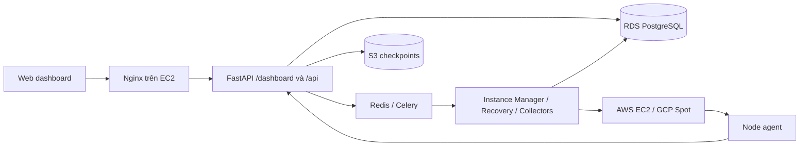

# Web dashboard

Giao diện tiếng Việt chạy tại **`/dashboard/`** trên cùng domain với API. Truy cập
`/` sẽ chuyển tới dashboard. Giao diện được đóng gói trong image control-plane
hiện tại, không cần Node.js, một web server khác hoặc một database khác.

## Chức năng

- Đăng nhập/đăng ký bằng tài khoản hiện có; phiên JWT được lưu trong
  `sessionStorage` của tab và xóa khi đăng xuất/hết hạn.
- Tổng quan số máy, chi phí Spot, chi phí giả định On-demand, chênh lệch, biểu đồ
  7/30/90 ngày và các lần khôi phục gần đây.
- Danh sách máy: tìm theo tên, lọc trạng thái, phân trang; giá mỗi giờ và chi phí
  tích lũy. Trạng thái phản ánh cả yêu cầu xóa và trường hợp cần người dùng xử lý.
- Chi tiết máy: tài nguyên yêu cầu/thực tế, IP và lệnh SSH, giá, lịch sử instance,
  lịch sử recovery, job, heartbeat và vị trí checkpoint trên S3. Có thao tác xóa
  và thử lại qua Instance Manager hiện có.
- Kết quả cuối cùng: hiển thị `workload_state` sau khi job hoàn thành, xem toàn bộ
  checkpoint và tải file `job-<job_id>-final.json`, kể cả khi instance đã bị xóa.
- Tạo máy qua ba bước: nhập nhu cầu → chọn đề xuất → xác nhận. Hỗ trợ CPU/RAM/GPU,
  disk, provider, region/zone, mục tiêu tối ưu, job ID và startup script tùy chọn.
  Ước tính số giờ trên form chỉ để so sánh, không phải lịch tự dừng máy.
- Thêm/liệt kê SSH public key để người dùng có thể hoàn thành luồng tạo máy.
- Tạo job từ file Python: upload → chọn tài nguyên/provider/chế độ tối ưu →
  đăng ký job và tạo máy → managed agent tự tải và chạy chương trình.
- Giao diện responsive, bảng cuộn ngang trên điện thoại; điều hướng bàn phím,
  thông báo lỗi/đang tải/trống và xác nhận trước khi xóa.

Tổng quan/danh sách/chi tiết được kiểm tra lại mỗi 15 giây khi tab đang hiển thị;
không thay nội dung lúc người dùng đang tương tác với form, nút hoặc bảng mở rộng.
Có nút làm mới thủ công. Đây là dữ liệu đã được worker đồng bộ vào database,
không phải truy vấn trực tiếp EC2/GCP mỗi lần mở trang.
Mở/đóng bảng số liệu theo ngày không làm dừng tự cập nhật; trạng thái mở và vị trí
focus ở tiêu đề bảng được giữ lại sau mỗi lần làm mới.

## Cách gắn vào kiến trúc hiện tại



Dashboard dùng các API auth/SSH/machines hiện có; API dashboard cung cấp mô hình
đọc tổng hợp, tính chi phí và đăng ký managed job. Tất cả `/api/dashboard*` đều bắt buộc đăng nhập và
lọc theo chủ sở hữu. Trình duyệt không nhận AWS credentials, launch network config,
agent token hoặc nội dung script đang chạy. Endpoint kết quả riêng chỉ trả
checkpoint cuối cho chủ sở hữu job.

| Thành phần đã đọc | Trách nhiệm và cách tích hợp |
| --- | --- |
| `app/main.py`, `auth.py`, `security.py`, `api_keys.py`, `ssh_keys.py`, `ssh.py` | Giữ cơ chế xác thực/phân quyền và SSH hiện có; thêm router/static mount |
| `app/models.py`, `database.py`, `init_db.py`, `seed.py` | Dùng schema hiện có; phân biệt Machine với lịch sử Instance; không dùng dữ liệu seed làm giá production |
| `app/services/catalog.py`, `placement.py`, `app/placement.py` | Lọc tài nguyên, giá, rủi ro và xếp hạng; thêm tùy chọn lọc theo launch allowlist |
| `app/services/instance_manager.py`, `launch_config.py`, `cloud_errors.py`, `app/machines.py` | Ghi ý định tạo/xóa bền vững; worker thực thi; ưu tiên ứng viên đã chọn và giữ fallback |
| `app/services/recovery.py`, `managed_agent.py` | Khôi phục từ yêu cầu ban đầu; không khóa recovery vào ứng viên ưu tiên |
| `app/adapters/{base,aws,gcp,cloud_init}.py` và script bootstrap/kiểm tra adapter | Cloud adapters tạo/xóa VM và cấu hình agent; dashboard không gọi trực tiếp |
| `app/services/market_data_collector.py`, `tasks.py`, `celery_app.py` | Giữ collector Spot/risk; thêm collector On-demand AWS hằng ngày |
| `app/agent_api.py`, `submissions.py`, `checkpoint_storage.py` | Hiển thị metadata checkpoint và tải checkpoint cuối để chủ sở hữu xem/xuất kết quả |
| Toàn bộ `node-agent/` | Agent chạy job/script, heartbeat, checkpoint và xử lý interruption; dashboard phản ánh trạng thái đã báo về |
| Toàn bộ `cli/` | Giữ tương thích API với CLI, bao gồm job/submission và Idempotency-Key |
| Test của control-plane, CLI, node-agent; Docker/Compose/Nginx, tài liệu Markdown và hai PDF dự án | Đối chiếu luồng thực tế trước khi viết; không thay mô hình EC2–RDS–S3 |

Mã mới chính: `app/dashboard.py`, `app/web.py`, `app/static/`,
`app/services/cost_and_metering.py`, `app/services/on_demand_pricing.py`.
Lỗi catalog không có region/zone dùng biến `conditions` chưa khởi tạo cũng đã
được sửa vì ảnh hưởng tra cứu cấu hình tổng quát.

## Chạy trên EC2

Dùng stack trong [README.md](README.md), cấu hình RDS bằng `DATABASE_URL` và
checkpoint bằng `SPULTI_CHECKPOINT_BUCKET` / `AWS_REGION` như hiện tại. Nếu máy
chưa có các bảng lifecycle/recovery/job, làm theo
[INSTANCE_MANAGER.md](INSTANCE_MANAGER.md) và [RECOVERY.md](RECOVERY.md).
Thay đổi dashboard này không thêm bảng/cột và không cần migration dữ liệu.

Tại thư mục `control-plane/` trên EC2:

```bash
docker compose build api
docker compose up -d api worker beat nginx
```

Sau đó mở `https://<domain-control-plane>/dashboard/` qua cấu hình HTTPS của môi
trường. Nginx hiện có chuyển tiếp `/` tới FastAPI nên không cần thêm route Nginx.
Compose hiện tại lắng nghe HTTP cổng 80; HTTPS cần được cung cấp ở reverse proxy
hoặc load balancer của môi trường triển khai. Dùng HTTPS khi đăng nhập ngoài máy
local. Không chạy `app.seed` để tạo số liệu cho dashboard trên production.

Để tạo máy, cần đủ cấu hình hiện có:

- `SPULTI_LAUNCH_CONFIG`: allowlist machine type/image/network theo provider,
  region và zone; catalog offerings phải khớp và có giá Spot.
- SSH public key của người dùng, quota cloud và quyền tạo/xóa instance của worker.
- Với managed job: public API URL, agent release URL/hash và S3 được cấu hình theo
  [RECOVERY.md](RECOVERY.md). Có thể upload trực tiếp ở **Tạo job mới**, hoặc nhập
  job ID đã tạo bằng CLI vào form tạo máy nâng cao.

## Upload Python và tạo job

Mở `/dashboard/#/submit-job`, chọn hoặc kéo thả file `.py` UTF-8 tối đa 16 KiB.
Tên file dùng chữ không dấu, số, dấu chấm, gạch ngang hoặc gạch dưới. Mặc định
`total_steps=1`, `step_delay=0`: toàn bộ file chạy một lượt. Chỉ tăng số bước khi
chương trình được thiết kế chạy lặp và lưu trạng thái qua `spulti.state`.

Chọn vCPU/RAM tối thiểu, AWS/GCP hoặc tự động, và chế độ tối ưu. Máy dùng đĩa
30 GiB; cần đăng ký SSH public key trước. Thư viện Python bên ngoài cần có sẵn
trong image. Form dùng `POST /api/dashboard/jobs` với `Idempotency-Key` UUID;
source, job và ý định tạo máy được lưu cùng giao dịch. Lỗi quota, cấu hình launch
hoặc managed agent không để lại job dở dang. API chỉ kiểm tra cú pháp, không chạy
file trên control plane.

Nếu mất phản hồi, tab giữ nguyên payload và key trong `sessionStorage`, kể cả
khi tải lại trang. Bấm **Kiểm tra / gửi lại job** để lấy đúng job/máy cũ.
Không gửi một yêu cầu mới khi chưa xác định kết quả yêu cầu đang chờ.

Managed agent cấp thư mục file checkpoint mặc định ở
`<state-dir>/files/<job-id>` và truyền vào chương trình qua `SPULTI_CHECKPOINT_DIR`.
Ví dụ `node-agent/examples/file_training.py` dùng thư mục này; chương trình phải
ghi file nguyên tử để đồng bộ snapshot nhất quán. File đồng bộ mặc định mỗi
300 giây, theo bước nếu bật, khi dừng và khi hoàn thành. Các bước chưa checkpoint
có thể chạy lại sau recovery. Cần phát hành lại archive node agent và cập nhật
URL/hash sau thay đổi `managed.py` để VM mới nhận hỗ trợ này.

Ở local, chạy stack theo [README.local.md](README.local.md), rồi mở
`http://localhost:8080/dashboard/` (hoặc `http://localhost:8000/dashboard/` nếu chạy
uvicorn trực tiếp). Giao diện dùng API cùng origin, không cần CORS hoặc URL API
riêng trong JavaScript.

## Xem và tải kết quả cuối cùng

Mở **Danh sách máy → chọn máy → Kết quả cuối cùng**. Khi job đã `COMPLETED` và
checkpoint cuối được lưu đủ số bước, dashboard hiển thị `workload_state`, cho
phép mở **Xem checkpoint cuối cùng** và bấm **Tải kết quả JSON**.
Máy đã xóa vẫn có trang chi tiết và tải được kết quả từ checkpoint lưu trên S3
(hoặc database với checkpoint cũ), không cần kết nối tới instance.

Chương trình phải lưu kết quả JSON vào `spulti.state`, ví dụ:

```python
from spulti import state, step_number

state["running_sum"] = state.get("running_sum", 0) + step_number**2
```

File tải về tên `job-<job_id>-final.json`, chứa toàn bộ checkpoint, bao gồm
`job_id`, `status`, `total_steps`, `last_completed_step` và `workload_state` nếu
có. Số nguyên lớn được giữ nguyên khi hiển thị và tải xuống. `print()` không được
thu thập thành kết quả; nếu job chỉ in ra log thì UI giải thích không có state,
nhưng vẫn tải được checkpoint. Nếu có `file_snapshot`, JSON giữ tham chiếu tới
bản lưu file; file model/dataset không được nhúng vào JSON.

API có xác thực bằng Bearer token của chủ sở hữu:

- `GET /api/dashboard/jobs/{job_id}/result`: nội dung kết quả và checkpoint dạng
  chuỗi JSON (`result_json`, `checkpoint_json`), cùng `filename`.
- Thêm `?download=true` để nhận trực tiếp checkpoint JSON với
  `Content-Disposition: attachment`.
- Job chưa xong trả `409`; thiếu checkpoint trả `404`; lỗi đọc/kiểm tra checkpoint
  trả `503` và dashboard có nút thử lại. Job không thuộc tài khoản trả `404`.

Tính năng này chỉ cần cập nhật image API/dashboard; không cần migration database
hay phát hành lại node-agent. Kết quả đã tải được giữ trong bộ nhớ của tab theo
job và thời điểm cập nhật, xóa khi đăng xuất; không lưu vào local/session storage.

## Dữ liệu On-demand

Worker gọi AWS Price List Query API cho **Linux / Shared tenancy / không phần mềm
cài sẵn**, lọc đúng `regionCode`, `marketoption=OnDemand` và
`operation=RunInstances`, lấy USD/giờ từ điều khoản OnDemand. Client Pricing
dùng endpoint `us-east-1`; giá vẫn thuộc region được yêu cầu. API có phân trang;
giữ thời điểm `effectiveDate` thay vì giả định giá có hiệu lực từ lúc thu thập.
Xem [AWS GetProducts](https://docs.aws.amazon.com/boto3/latest/reference/services/pricing/client/get_products.html)
và [Price List Query API](https://docs.aws.amazon.com/awsaccountbilling/latest/aboutv2/using-price-list-query-api.html).

Collector bỏ giá bằng 0 và chỉ nhận một mức giá duy nhất tại thời điểm hiệu lực
mới nhất sau khi đọc hết các trang. Nếu một loại máy, ví dụ `p5en.48xlarge`, vẫn
có nhiều giá khác nhau ở mốc mới nhất, collector ghi warning và bỏ riêng loại đó;
các loại máy khác vẫn được lưu. Không chọn giá thấp/cao nhất hoặc dùng lại mốc
cũ để che xung đột. Kết quả `partial` kèm `prices_missing` báo thiếu giá một phần;
`empty` nghĩa là không nhận được giá hợp lệ. Lọc `marketoption=OnDemand` cũng
được dùng trong [collector của AWS Karpenter](https://github.com/aws/karpenter-provider-aws/blob/main/pkg/providers/pricing/pricing.go).

Role/profile được worker sử dụng cần thêm quyền **`pricing:GetProducts`**.
Collector dùng chuỗi credentials chuẩn của boto3, không nhận khóa từ dashboard.
`MARKET_AWS_REGIONS` chọn vùng thu thập; `MARKET_LIMIT_TYPES` giới hạn danh mục
như các collector hiện có (để trống để lấy toàn bộ catalog). Các type nằm ngoài
giới hạn sẽ không tự có giá mới.

Celery beat lên lịch lúc **00:50 UTC mỗi ngày**. Có thể khởi chạy lần đầu qua
worker mà không chờ lịch:

```bash
docker compose exec worker celery -A app.celery_app:celery_app call spulti.market.collect --args='["AWS","on_demand"]'
```

Lệnh trả về task ID; xem log worker để xác nhận `prices_received`/`prices_saved`
và lỗi credentials/network. Lỗi hoặc giá thiếu không được thay bằng tỷ lệ giảm
giá cố định. Chạy duy nhất một beat theo cấu hình hiện có.

**GCP:** worker dùng [Cloud Billing Catalog API](https://docs.cloud.google.com/billing/docs/reference/rest/v1/services.skus/list)
để thu thập giá Compute Engine On-demand bằng USD. Collector hỗ trợ E2 predefined
(`e2-micro/small/medium`, `e2-standard-*`, `e2-highcpu-*`, `e2-highmem-*`),
lấy đúng `serviceRegions` rồi cộng giá CPU và RAM theo cấu hình trong catalog.
E2 shared-core dùng lần lượt **0.25 / 0.5 / 1 vCPU tính phí**, thay vì 2 vCPU
hiển thị trong guest. Custom types, GPU, các dòng máy khác, giá Spot, commitment,
license và free-tier discount không được dùng làm giá so sánh.

Worker dùng GCP Application Default Credentials đã cấu hình, không cần API key
mới hay thay đổi schema. Bật **Cloud Billing API (`cloudbilling.googleapis.com`)**
trong project cấp credentials; credentials cần OAuth scope `cloud-platform`
(collector yêu cầu scope này). API được đọc có phân trang một lần cho các region.
`MARKET_GCP_ZONES` xác định các region cần thu thập, ví dụ
`asia-southeast1-b,asia-northeast1-a` cho Singapore và Tokyo.
`MARKET_LIMIT_TYPES` giới hạn các E2 được hỗ trợ, sau khi lọc các loại máy khác.

Celery Beat gửi task lúc **01:05 UTC / 08:05 giờ Việt Nam mỗi ngày**. Có thể
gửi ngay sau khi triển khai:

```bash
docker compose exec worker python -c "from app.tasks import collect_market_data; print(collect_market_data.delay('GCP', 'on_demand').id)"
```

Giá lưu trong `spot_prices` với `price_type=ON_DEMAND`, zone rỗng và thời điểm
hiệu lực là thời điểm muộn hơn của hai giá CPU/RAM. Catalog mặc định chỉ trả
giá mới nhất, có thể được ghi nhận trong 12 giờ vừa qua; collector **không tự
gán giá hiện tại cho thời gian chạy cũ**. Dashboard có thể hiện đơn giá hiện tại
nhưng tổng lịch sử vẫn thiếu dữ liệu. `status=partial` và `prices_missing` báo
thiếu giá ở một phần các region; `empty` nghĩa là chưa nhận được giá hoặc chưa có
E2 trong catalog. Khi thiếu, UI tiếp tục hiển thị `—` và số giờ thiếu giá.

## Ý nghĩa con số chi phí

Chi phí là **ước tính compute**, không phải hóa đơn AWS/GCP:

```text
chi phí = tổng (số giây instance chạy trong khoảng × đơn giá/giờ của khoảng / 3600)
```

- Biểu đồ mặc định **Lũy kế**: điểm cuối bằng tổng chi phí trong kỳ đang chọn.
  Chuyển sang **Theo ngày** để xem riêng từng ngày UTC. Ví dụ ngày 12 tốn
  `$0.0709`, ngày 13 tốn `$0.0236` thì tổng kỳ là `$0.0945`; đường theo ngày không
  kết thúc ở `$0.0945`. Bảng bên dưới luôn liệt kê chi phí riêng của từng ngày.
- On-demand là chi phí giả định nếu chạy On-demand, không phải khoản đã thanh
  toán thêm. Nếu thiếu giá của một đoạn thời gian, các ô chi phí và biểu đồ vẫn
  hiển thị phần đã tính được với dấu **≥** và ghi rõ số giờ thiếu giá. Đường chứa
  dữ liệu chưa đầy đủ có nét đứt; tooltip ghi **phần đã tính được**. Tổng đầy đủ
  và chênh lệch tiết kiệm vẫn chưa xác định, không coi giá thiếu là giá bằng 0.
  Thu thập lại giá hiện tại không đảm bảo bổ sung được toàn bộ lịch sử cũ.
- Tổng quan cộng tất cả instance có thời gian chạy trong kỳ, kể cả máy đã xóa
  và các instance trước recovery. Số **Máy đang quản lý** chỉ đếm máy chưa xóa.
  Vì vậy hai máy hiện tại đủ giá vẫn có thể đi kèm tổng kỳ thiếu giá của máy cũ.
  Mở **Thiếu lịch sử giá ở … máy trong kỳ** để xem tên/trạng thái, số giờ thiếu
  giá Spot và On-demand, cùng liên kết đến chi tiết từng máy (tối đa 20 máy).
  API tổng quan trả `missing_price_machine_count` và `missing_price_machines`,
  chỉ gồm dữ liệu thuộc tài khoản đang đăng nhập.
- Dùng `Decimal` và chỉ làm tròn kết quả API tới 6 chữ số thập phân. Frontend
  định dạng USD; dự tính số giờ trên form là phép nhân đơn giản theo giá hiện tại.
- Chia khoảng tại mỗi lần giá thay đổi, lúc bắt đầu/kết thúc instance và ranh
  giới ngày UTC. Khoảng gián đoạn giữa các instance không bị cộng thời gian.
- AWS collector giữ tất cả mốc giá trả về trong cửa sổ một giờ, kể cả giá có
  hiệu lực trước đầu cửa sổ, thay vì chỉ giữ mốc mới nhất của mỗi loại máy/zone.
  Các mốc trùng giữa các trang/lượt thu thập được loại trùng. Xem
  [DescribeSpotPriceHistory](https://docs.aws.amazon.com/AWSEC2/latest/APIReference/API_DescribeSpotPriceHistory.html).
- Một Machine có thể có nhiều Instance khác loại, zone hoặc cloud. Tính từng
  instance theo giá của chính loại máy/vùng đó rồi cộng lại; không tính lại lịch
  sử theo cấu hình hiện tại.
- Giá zone được ưu tiên hơn giá region kể từ thời điểm hiệu lực. Không mượn giá
  zone khác hoặc lấy giá tương lai để lấp lịch sử còn thiếu.
- Thiếu giá ở bất kỳ khoảng nào: API giữ tổng tương ứng và chênh lệch là `null`;
  UI dùng `known_spot_cost` / `known_on_demand_cost` để hiển thị số tiền tối thiểu
  đã tính được, kèm số giờ thiếu giá. Chênh lệch vẫn hiện `—`. Đây là lý do
  dữ liệu mới thu thập có thể chưa đủ để so sánh toàn bộ vòng đời máy cũ.
- Giá hiện tại tiếp tục dùng bản ghi gần nhất có hiệu lực như placement hiện có;
  chưa áp dụng thời hạn hết hiệu lực cho dữ liệu market. UI hiển thị thời điểm
  giá để người dùng đánh giá độ mới. Collector phải được giám sát vận hành.
- **Giá Spot/On-demand có hiệu lực từ** là thời điểm nhà cung cấp bắt đầu áp dụng
  đơn giá, không phải lần collector chạy gần nhất. Với GCP Spot, thời điểm này
  lấy từ `priceHistory[].interval.startTime`. Nếu API tiếp tục trả cùng giá và
  thời điểm hiệu lực, collector loại trùng nên ngày hiển thị có thể giữ nguyên
  dù đã thu thập lại thành công. Xem log worker hoặc kết quả task để kiểm tra lần
  thu thập; không đổi mốc hiệu lực sang thời gian hiện tại vì sẽ làm sai lịch sử
  tính chi phí.
- `started_at`/`ended_at` là thời điểm control-plane ghi nhận, có thể lệch với
  thời gian billing chính xác. Chưa áp dụng minimum billing/rounding riêng của
  từng provider; chưa gồm disk, mạng, IP, control-plane EC2, RDS, S3, thuế,
  credit, Savings Plans/commitments hoặc phí phần mềm.
- Bảng `CostRecord` cũ không được cộng vào phép tính vì snapshot không có cửa sổ
  thời gian rõ ràng và có thể trùng lặp. Dashboard không ghi đè bảng này.

## Quy tắc chọn máy và chống tạo trùng

`POST /api/placement/recommendations?launchable_only=true` lọc launch allowlist
**trước** khi xếp hạng và giới hạn số ứng viên. API recommendation mặc định giữ
hành vi cũ cho CLI. API chỉ trả location đã cấu hình, không trả subnet/image/keys.

`POST /api/machines` nhận thêm trường tùy chọn:

```json
{
  "preferred_candidate": {
    "machine_type_id": 123,
    "region": "ap-southeast-1",
    "zone": "ap-southeast-1a"
  }
}
```

Đây là phần bổ sung vào body tạo máy hiện có. Server xác minh lại ứng viên đáp
ứng nhu cầu và còn trong danh sách xếp hạng. Nếu không còn phù hợp, trả 409 và yêu
cầu tìm lại cấu hình. Nếu phù hợp, đưa ứng viên lên đầu; các ứng viên khác vẫn
được giữ để fallback. Recovery và lần thử lại thủ công xếp hạng lại theo nhu cầu
ban đầu, bỏ qua ưu tiên ban đầu. Hai chế độ SAVING/STABLE đều sử dụng Spot; không đổi sang
On-demand. Recommendation không đảm bảo quota hoặc capacity còn sẵn.

Dashboard lưu body/mã `Idempotency-Key` trước khi gửi. Nếu mất phản hồi hoặc lỗi
5xx, yêu cầu được giữ qua reload để gửi lại cùng mã. Server tiếp tục dùng ý định
đã commit thay vì tạo máy mới. Payload CLI cũ không có trường ưu tiên vẫn replay
được. Người dùng có thể bỏ yêu cầu đã lưu sau khi kiểm tra danh sách máy.

## Kiểm thử

Từ thư mục gốc repo, PowerShell:

```powershell
$env:PYTHONPATH = "$PWD\control-plane"
.\.venv\Scripts\python.exe -m unittest discover -s control-plane/tests
.\.venv\Scripts\python.exe -m ruff check .
.\.venv\Scripts\python.exe -m ruff format --check .
```

`tests/test_dashboard.py` kiểm tra biến động giá, nhiều instance/gián đoạn,
UTC, khoảng thời gian, giá thiếu/khác zone/tương lai, owner isolation, checkpoint
metadata, phân trang/tìm kiếm, allowlist, ứng viên ưu tiên, recovery, tương thích
idempotency, static headers và AWS Pricing phân trang.

Kiểm tra trình duyệt tùy chọn (không thêm dependency vào image production):

```powershell
.\.venv\Scripts\python.exe -m pip install playwright
# Dùng Chrome cài trên máy; hoặc chỉ rõ DASHBOARD_BROWSER tới browser executable.
.\.venv\Scripts\python.exe control-plane/tests/dashboard_browser.py
```

Script khởi động FastAPI với SQLite tạm và cloud fixtures, vô hiệu hóa lời gọi
worker, tự đóng server/browser sau kiểm thử. Không gọi AWS/GCP/RDS/S3 thật.
Kiểm tra đăng nhập, tổng quan, tìm kiếm, chi tiết, responsive, đề xuất/tạo máy,
mất phản hồi POST và gửi lại, xóa, SSH key, lỗi API, hết phiên, HTML escaping và
CSP. Ảnh minh họa dùng dữ liệu test nằm tại `.local/dashboard-preview/`.

Test tích hợp PostgreSQL của repo chỉ chạy khi cấu hình `TEST_POSTGRES_URL`.
Kiểm thử local không thay thế lần kiểm tra triển khai với RDS, IAM role, Redis,
cloud capacity và S3 của môi trường thật.
